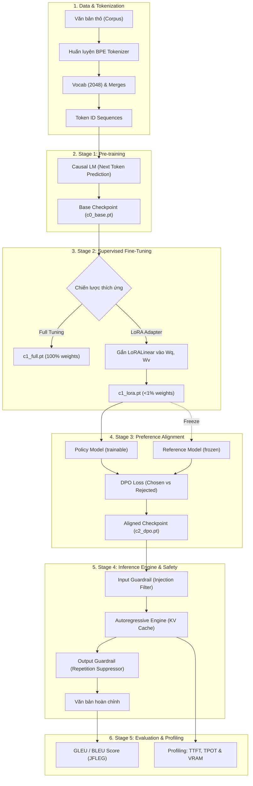
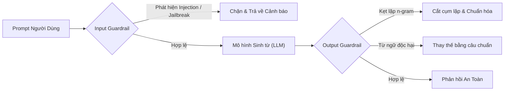

# Hướng Dẫn Kỹ Thuật: Luồng Triển Khai Chi Tiết Huấn Luyện Mini LLM Từ Con Số 0
*(From-Scratch Mini Causal Language Model: Architecture, Training, Alignment & Inference Pipeline)*

> **Phiên bản:** 1.0.0  
> **Dự án mẫu:** AlignForge English  
> **Mục tiêu:** Cung cấp tài liệu kỹ thuật hoàn chỉnh, bóc tách tường minh từng module nhỏ để lập trình viên có thể tự tay triển khai từ đầu một mô hình ngôn ngữ lớn cỡ nhỏ (~3.67M tham số) bao gồm toàn bộ vòng đời: **Tokenizer $\to$ Model Architecture $\to$ Pre-training $\to$ LoRA SFT $\to$ DPO Alignment $\to$ Dynamic KV Cache $\to$ Guardrails $\to$ Evaluation**.

---

## Mục Lục

1. [Tổng Quan Kiến Trúc & Vòng Đời Triển Khai (End-to-End Pipeline)](#1-tổng-quan-kiến-trúc--vòng-đời-triển-khai)
2. [Thông Số Kỹ Thuật Tiêu Chuẩn (Hyperparameters Specification)](#2-thông-số-kỹ-thuật-tiêu-chuẩn)
3. [Phần 1: Bộ Tách Từ Byte-Pair Encoding (BPE Tokenizer)](#phần-1-bộ-tách-từ-byte-pair-encoding-bpe-tokenizer)
4. [Phần 2: Kiến Trúc Causal Decoder-Only Transformer (From Scratch)](#phần-2-kiến-trúc-causal-decoder-only-transformer-from-scratch)
   - [2.1 RMSNorm (Root Mean Square Layer Normalization)](#21-rmsnorm)
   - [2.2 Rotary Position Embedding (RoPE)](#22-rotary-position-embedding-rope)
   - [2.3 Causal Multi-Head Self-Attention](#23-causal-multi-head-self-attention)
   - [2.4 Feed-Forward Network (GELU FFN)](#24-feed-forward-network-gelu-ffn)
   - [2.5 Weight Tying & Embedding](#25-weight-tying--embedding)
5. [Phần 3: Tiền Huấn Luyện (Pre-training / Base Model C0)](#phần-3-tiền-huấn-luyện-pre-training--base-model-c0)
6. [Phần 4: Tinh Chỉnh Chỉ Dẫn (SFT: Full vs LoRA PEFT)](#phần-4-tinh-chỉnh-chỉ-dẫn-sft-full-vs-lora-peft)
   - [4.1 Kỹ thuật sống còn: Prompt Loss Masking](#41-kỹ-thuật-sống-còn-prompt-loss-masking)
   - [4.2 Tự lập trình LoRA (Low-Rank Adaptation) từ đầu](#42-tự-lập-trình-lora-low-rank-adaptation-từ-đầu)
7. [Phần 5: Căn Chỉnh Sở Thích Hành Vi (DPO - Direct Preference Optimization)](#phần-5-căn-chỉnh-sở-thích-hành-vi-dpo---direct-preference-optimization)
   - [5.1 Đột phá toán học của DPO so với RLHF/PPO](#51-đột-phá-toán-học-của-dpo-so-với-rlhfppo)
   - [5.2 Kỹ thuật tính Response-Masked Log Probabilities](#52-kỹ-thuật-tính-response-masked-log-probabilities)
   - [5.3 Cơ chế Reference Model & Giám sát Margin](#53-cơ-chế-reference-model--giám-sát-margin)
8. [Phần 6: Bộ Sinh Từ Tự Hồi Quy & Tối Ưu Hóa KV Cache (Generation & KV Cache)](#phần-6-bộ-sinh-từ-tự-hồi-quy--tối-ưu-hóa-kv-cache)
   - [6.1 Vòng đời Autoregressive Decoding](#61-vòng-đời-autoregressive-decoding)
   - [6.2 Phân tích độ phức tạp & Cài đặt Dynamic Tensor KV Cache](#62-phân-tích-độ-phức-tạp--cài-đặt-dynamic-tensor-kv-cache)
   - [6.3 Chiến lược lấy mẫu (Sampling Strategies)](#63-chiến-lược-lấy-mẫu-sampling-strategies)
9. [Phần 7: Hệ Thống Rào Chắn An Toàn (Deterministic Safety Guardrails)](#phần-7-hệ-thống-rào-chắn-an-toàn-deterministic-safety-guardrails)
10. [Phần 8: Đo Lường & Đánh Giá Thực Nghiệm (Evaluation Framework)](#phần-8-đo-lường--đánh-giá-thực-nghiệm-evaluation-framework)
11. [Phần 9: Cấu Trúc Mã Nguồn & Clean Architecture (Software Design)](#phần-9-cấu-trúc-mã-nguồn--clean-architecture)
12. [Phần 10: Checklist Triển Khai Từng Bước & Những Lỗi Kinh Điển](#phần-10-checklist-triển-khai-từng-bước--những-lỗi-kinh-điển)

---

## 1. Tổng Quan Kiến Trúc & Vòng Đời Triển Khai

Một hệ thống LLM hoàn chỉnh không chỉ dừng lại ở mô hình mạng nơ-ron, mà là một chuỗi đường ống dẫn dữ liệu (pipeline) khép kín, trong đó mỗi giai đoạn giải quyết một bài toán cụ thể:



---

## 2. Thông Số Kỹ Thuật Tiêu Chuẩn

Mô hình Mini LLM được thiết kế theo cấu hình tiêu chuẩn nhằm đảm bảo:
1. **Tính độc lập phần cứng:** Huấn luyện mượt mà trên Google Colab T4 (16GB VRAM) hoặc thậm chí kiểm thử trực tiếp trên CPU cá nhân.
2. **Kích thước nhỏ nhưng đầy đủ cơ chế:** Đạt quy mô ~3.67M tham số, hội tụ chỉ sau vài nghìn bước huấn luyện trên tập dữ liệu tinh gọn.

| Thuộc tính | Ký hiệu | Giá trị tiêu chuẩn | Ý nghĩa & Vai trò kỹ thuật |
|---|---|---|---|
| **Kích thước từ điển** | $V$ (`vocab_size`) | `2048` | Kích thước từ điển BPE byte-level, đủ đại diện ngôn ngữ mà không tốn VRAM cho ma trận Embedding |
| **Chiều ẩn** | $d_{\text{model}}$ | `256` | Kích thước vector biểu diễn ẩn qua các tầng |
| **Số đầu chú ý** | $n_{\text{heads}}$ | `4` | Số luồng Self-Attention độc lập song song |
| **Kích thước mỗi đầu** | $d_{\text{head}}$ | `64` | $d_{\text{head}} = d_{\text{model}} / n_{\text{heads}} = 256 / 4 = 64$ |
| **Số tầng Transformer** | $n_{\text{layers}}$ | `4` | Độ sâu ngăn xếp Transformer Decoder blocks |
| **Chiều ẩn FFN** | $d_{\text{ff}}$ | `1024` | Kích thước tầng trung gian của Feed-Forward ($4 \times d_{\text{model}}$) |
| **Ngữ cảnh tối đa** | $L_{\max}$ (`max_seq_len`) | `2048` | Chiều dài chuỗi tối đa hỗ trợ trong RoPE và KV Cache |
| **Cơ số RoPE** | $\theta_{\text{base}}$ | `10000.0` | Chu kỳ tần số cơ sở cho Rotary Position Embeddings |
| **Tham số LoRA** | $r, \alpha$ | $r=8, \alpha=16$ | Rank nén thấp và hệ số scaling trọng số thích ứng |
| **Trọng số DPO** | $\beta$ | `0.1` | Hệ số phạt độ lệch KL divergence giữa Policy và Reference |

---

## Phần 1: Bộ Tách Từ Byte-Pair Encoding (BPE Tokenizer)

### 1.1 Tại sao cần Byte-Level BPE?
Trong xử lý ngôn ngữ tự nhiên hiện đại, việc phân tách từ theo khoảng trắng (Word-level) sinh ra tập từ điển khổng lồ và gặp lỗi Out-Of-Vocabulary (OOV). Trong khi đó, Character-level làm chuỗi token bị kéo dài quá mức, khiến bộ nhớ chú ý ($O(T^2)$) bùng nổ.

**Byte-Level BPE** giải quyết triệt để vấn đề này bằng cách:
1. Khởi tạo từ điển cơ sở với **256 byte** (từ `0x00` đến `0xFF` theo chuẩn UTF-8).
2. Mọi ký tự hoặc chuỗi unicode bất kỳ đều được phân rã thành các byte $\implies$ **Hoàn toàn không bao giờ gặp lỗi OOV**.
3. Lặp lại quá trình hợp nhất (merge) các cặp byte kề nhau xuất hiện nhiều nhất trong văn bản cho đến khi đạt kích thước từ điển mục tiêu.

### 1.2 Các Special Tokens bắt buộc
Bộ tách từ cần định nghĩa sẵn 4 token đặc biệt được gán ID cố định ở đầu từ điển:

```python
SPECIAL_TOKENS = {
    "<pad>": 0,  # Dùng để căn độ dài đồng đều trong batch
    "<bos>": 1,  # Đánh dấu điểm bắt đầu chuỗi (Beginning of Sequence)
    "<eos>": 2,  # Đánh dấu điểm kết thúc chuỗi (End of Sequence)
    "<unk>": 3,  # Ký tự chưa nhận diện (fallback dự phòng)
}
```

### 1.3 Thuật toán Huấn luyện BPE
Quy trình huấn luyện từ điển từ một tập văn bản thô:
1. Biến đổi toàn bộ văn bản đầu vào thành danh sách các chuỗi byte.
2. Đếm tần suất xuất hiện của tất cả các cặp mã kề nhau `(id_a, id_b)`.
3. Tìm cặp có tần suất xuất hiện lớn nhất $\max(\text{count})$.
4. Gán một token ID mới cho cặp này, lưu quy tắc hợp nhất vào danh sách `merges`.
5. Thay thế tất cả các cặp đó trong dữ liệu và lặp lại cho tới khi $|V| = \text{vocab\_size}$.

```python
def train_bpe(texts: list[str], target_vocab_size: int = 2048):
    # Khởi tạo vocab với special tokens và 256 giá trị byte gốc
    vocab = {i: bytes([i - 4]) for i in range(4, 260)}
    # Bắt đầu vòng lặp tìm cặp byte xuất hiện nhiều nhất và merge
    # ...
    return vocab, merges
```

### 1.4 Hàm Encode và Decode
- **Encode:** Chuyển văn bản thành danh sách byte $\to$ duyệt qua danh sách các cặp đã học trong `merges` theo thứ tự ưu tiên $\to$ gom cụm cho đến khi không còn cặp nào khớp $\to$ trả về danh sách token ID.
- **Decode:** Ánh xạ ngược danh sách token ID thành các chuỗi byte $\to$ ghép lại $\to$ gọi `bytes.decode("utf-8", errors="replace")`.

*Mã nguồn tham chiếu:* [`src/alignforge/infrastructure/tokenization/bpe_tokenizer.py`](file:///home/phuqy/Develop/AlignForce/src/alignforge/infrastructure/tokenization/bpe_tokenizer.py)

---

## Phần 2: Kiến Trúc Causal Decoder-Only Transformer (From Scratch)

Kiến trúc mô hình tuân thủ thiết kế hiện đại (Pre-LayerNorm, RoPE, RMSNorm, Weight Tying) tương tự LLaMA và Mistral:

```
Input Tokens: [B, T]
     │
     ▼
Token Embedding Layer ─── (Weight Tying với LM Head)
     │
     ▼
[Transformer Block 1] ─── RMSNorm ──► Causal Self-Attention (RoPE) ──► Add (Residual)
     │                     └── RMSNorm ──► GELU Feed-Forward (d_ff) ──► Add (Residual)
     ▼
[Transformer Block 2]
     │
     ▼
[Transformer Block 3]
     │
     ▼
[Transformer Block 4]
     │
     ▼
Final RMSNorm
     │
     ▼
LM Head (Linear d_model -> vocab_size) ──► Logits [B, T, V]
```

### 2.1 RMSNorm

Thay vì sử dụng LayerNorm truyền thống (cần tính cả kỳ vọng $\mu$ và phương sai $\sigma^2$), **RMSNorm** chứng minh rằng chỉ cần chuẩn hóa dựa trên bình phương trung bình trọng số (Root Mean Square) là đủ để ổn định gradient, đồng thời giảm đáng kể chi phí tính toán:

$$\text{RMSNorm}(x) = \frac{x}{\sqrt{\frac{1}{d} \sum_{i=1}^d x_i^2 + \epsilon}} \odot \gamma$$

Trong đó $\gamma$ là vector tham số học được (khởi tạo bằng 1), $\epsilon = 10^{-5}$ chống chia cho 0.

```python
class RMSNorm(nn.Module):
    def __init__(self, dim: int, eps: float = 1e-5):
        super().__init__()
        self.eps = eps
        self.weight = nn.Parameter(torch.ones(dim))

    def forward(self, x: torch.Tensor) -> torch.Tensor:
        # x shape: [batch, seq_len, dim]
        variance = x.pow(2).mean(dim=-1, keepdim=True)
        return x * torch.rsqrt(variance + self.eps) * self.weight
```

### 2.2 Rotary Position Embedding (RoPE)

Thay vì cộng trực tiếp vector vị trí vào embedding (như GPT-2), **RoPE** mã hóa thông tin vị trí bằng cách xoay trực tiếp các cặp vector trong không gian biểu diễn 2D của Query ($Q$) và Key ($K$).

**Nguyên lý toán học:**
Tích vô hướng giữa Query tại vị trí $m$ và Key tại vị trí $n$ sau khi xoay sẽ chỉ phụ thuộc vào khoảng cách tương đối $m - n$:

$$\langle \mathbf{R}_{\Theta, m} \mathbf{q}, \mathbf{R}_{\Theta, n} \mathbf{k} \rangle = g(\mathbf{q}, \mathbf{k}, m-n)$$

Tần số góc tại chiều thứ $i$ ($i \in [0, d_{\text{head}}/2)$):
$$\theta_i = \theta_{\text{base}}^{-2i / d_{\text{head}}}, \quad \theta_{\text{base}} = 10000.0$$

Phép biến đổi xoay nửa vector (`rotate_half`):
$$R(x) = [-x_2, x_1]$$
$$\text{RoPE}(x, m) = (x \odot \cos(m\Theta)) + (\text{rotate\_half}(x) \odot \sin(m\Theta))$$

```python
def rotate_half(x: torch.Tensor) -> torch.Tensor:
    half = x.shape[-1] // 2
    x1, x2 = x[..., :half], x[..., half:]
    return torch.cat((-x2, x1), dim=-1)

def apply_rotary_pos_emb(q, k, cos, sin):
    # cos, sin shape: [1, 1, seq_len, head_dim]
    q_embed = (q * cos) + (rotate_half(q) * sin)
    k_embed = (k * cos) + (rotate_half(k) * sin)
    return q_embed, k_embed
```

### 2.3 Causal Multi-Head Self-Attention

Module Attention chịu trách nhiệm tính toán mức độ phụ thuộc giữa các từ. Điểm cốt tử của mô hình Causal (tự hồi quy) là **không được phép nhìn thấy từ tương lai**.

1. **Chiếu tuyến tính:** $Q = X W_q$, $K = X W_k$, $V = X W_v$ với shape $[B, T, d_{\text{model}}]$.
2. **Tách Head:** Reshape thành $[B, n_{\text{heads}}, T, d_{\text{head}}]$.
3. **Áp dụng RoPE:** Xoay $Q$ và $K$ theo vị trí thời gian tương ứng.
4. **Causal Masking:** Tạo ma trận tam giác dưới với $-\infty$ ở phần tam giác trên:

$$\text{Attention}(Q, K, V) = \text{Softmax}\left( \frac{Q K^T}{\sqrt{d_{\text{head}}}} + M \right) V, \quad M_{ij} = \begin{cases} 0 & \text{khi } j \le i \\ -\infty & \text{khi } j > i \end{cases}$$

```python
scores = torch.matmul(q, k.transpose(-2, -1)) / math.sqrt(self.head_dim)
# Áp dụng causal mask nếu không có sẵn cache
if mask is not None:
    scores = scores + mask
attn_weights = F.softmax(scores, dim=-1)
out = torch.matmul(attn_weights, v)
```

### 2.4 Feed-Forward Network (GELU FFN)

Tầng phi tuyến tính mở rộng không gian đặc trưng từ $d_{\text{model}} \to d_{\text{ff}} \to d_{\text{model}}$:

$$\text{FFN}(x) = \text{Linear}_2(\text{GELU}(\text{Linear}_1(x)))$$

### 2.5 Weight Tying & Embedding

Chia sẻ trọng số giữa ma trận embedding từ và ma trận chiếu phân phối từ vựng cuối cùng (LM Head):
```python
self.tok_embeddings = nn.Embedding(self.vocab_size, self.d_model)
self.lm_head = nn.Linear(self.d_model, self.vocab_size, bias=False)
# Chia sẻ vùng nhớ trọng số (Weight Tying)
self.tok_embeddings.weight = self.lm_head.weight
```
**Lợi ích:** Tiết kiệm $2048 \times 256 = 524,288$ tham số (~15% mô hình), giúp gradient phản hồi trực tiếp từ loss về embedding nhanh và ổn định hơn.

*Mã nguồn tham chiếu:* [`src/alignforge/infrastructure/models/layers.py`](file:///home/phuqy/Develop/AlignForce/src/alignforge/infrastructure/models/layers.py), [`src/alignforge/infrastructure/models/transformer.py`](file:///home/phuqy/Develop/AlignForce/src/alignforge/infrastructure/models/transformer.py)

---

## Phần 3: Tiền Huấn Luyện (Pre-training / Base Model C0)

### 3.1 Mục Tiêu: Causal Language Modeling
Pre-training trang bị cho mô hình kiến thức ngôn ngữ nền tảng bằng cách dự đoán token kế tiếp trên kho ngữ liệu tổng quát (ví dụ: `TinyStories`):

$$\mathcal{L}_{\text{CLM}} = -\frac{1}{T} \sum_{t=1}^T \log P(x_t \mid x_1, x_2, \dots, x_{t-1})$$

### 3.2 Chuẩn Bị Dữ Liệu Dạng Chunking Cố Định
Toàn bộ văn bản sau khi tokenize được nối thành một chuỗi token IDs dài liên tục, sau đó cắt thành các lát (chunks) có độ dài $L+1$:
- Đầu vào mô hình ($x$): `chunk[:-1]` (độ dài $L$)
- Nhãn mục tiêu ($y$): `chunk[1:]` (độ dài $L$, dịch chuyển 1 vị trí về bên phải)

### 3.3 Quy Trình Vòng Lặp Huấn Luyện Tối Ưu

```python
# Tự động hóa Mixed Precision (FP16) và Gradient Scaling
scaler = torch.amp.GradScaler("cuda", enabled=use_amp)

for batch in dataloader:
    x, y = batch[0].to(device), batch[1].to(device)
    optimizer.zero_grad()
    
    with torch.amp.autocast("cuda", enabled=use_amp):
        logits = model(x) # [Batch, Seq_Len, Vocab_Size]
        loss = F.cross_entropy(logits.view(-1, vocab_size), y.view(-1))
        
    scaler.scale(loss).backward()
    scaler.unscale_(optimizer)
    torch.nn.utils.clip_grad_norm_(model.parameters(), max_norm=1.0) # Tránh bùng nổ gradient
    scaler.step(optimizer)
    scaler.update()
    scheduler.step()
```

### 3.4 Chỉ Số Đánh Giá: Perplexity (PPL)
Perplexity đo lường "mức độ bất ngờ" của mô hình khi dự đoán từ tiếp theo. PPL càng thấp, mô hình dự đoán càng chính xác:
$$\text{PPL} = \exp(\mathcal{L})$$

*Mã nguồn tham chiếu:* [`src/alignforge/infrastructure/training/pretrainer.py`](file:///home/phuqy/Develop/AlignForce/src/alignforge/infrastructure/training/pretrainer.py)

---

## Phần 4: Tinh Chỉnh Chỉ Dẫn (SFT: Full vs LoRA PEFT)

Sau giai đoạn C0, mô hình chỉ biết viết tiếp văn bản một cách ngẫu nhiên. Giai đoạn **SFT (Supervised Fine-Tuning)** dạy mô hình tuân thủ mệnh lệnh và thực hiện tác vụ chuyên biệt (ví dụ: Sửa lỗi ngữ pháp - Grammar Error Correction).

### 4.1 Kỹ thuật sống còn: Prompt Loss Masking

Khi huấn luyện trên cặp `(Prompt, Completion)`:
- Nếu ta tính loss trên toàn bộ chuỗi, mô hình sẽ bị phân tán năng lực học để "học thuộc lòng" cả câu hỏi của người dùng.
- **Giải pháp:** Sử dụng mã nhãn đặc biệt `-100` (`ignore_index` mặc định của PyTorch CrossEntropyLoss) để triệt tiêu toàn bộ gradient trên các vị trí thuộc về Prompt:

```
Token IDs: [BOS]  Fix  grammar :  She  go  home . [EOS]
Prompt:    [BOS]  Fix  grammar :  She  go
Completion: She went home . [EOS]

Target y:  [-100, -100, -100, -100, -100, 'went', 'home', '.', EOS]
            ^^^^^^^^^^^^^^^^^^^^^^^^^^^^  ^^^^^^^^^^^^^^^^^^^^^^^^^^
            Masked (Loss = 0)             Supervised (Tính Loss)
```

```python
prompt_ids = tokenizer.encode(prompt, add_bos=True)
comp_ids = tokenizer.encode(completion, add_eos=True)

total_ids = prompt_ids + comp_ids
# Gán -100 cho toàn bộ prompt
labels = [-100] * len(prompt_ids) + list(comp_ids)
```

### 4.2 Tự Lập Trình LoRA (Low-Rank Adaptation) từ đầu

#### Nguyên lý toán học:
Một ma trận trọng số $W_0 \in \mathbb{R}^{d \times k}$ khi thích ứng với tác vụ mới thường có rank nội tại thấp (low intrinsic dimension). Thay vì cập nhật trực tiếp $W_0$, LoRA phân rã ma trận gia số $\Delta W$ thành tích của hai ma trận rank thấp:

$$W = W_0 + \Delta W = W_0 + \frac{\alpha}{r} (B \cdot A)$$
Trong đó:
- $W_0 \in \mathbb{R}^{d \times k}$: Trọng số gốc, bị **đóng băng hoàn toàn** (`requires_grad = False`).
- $A \in \mathbb{R}^{r \times k}$: Khởi tạo ngẫu nhiên theo phân phối Kaiming Uniform.
- $B \in \mathbb{R}^{d \times r}$: Khởi tạo hoàn toàn bằng **0**.
- $r \ll \min(d, k)$: Hạng nén (ví dụ $r=8$).
- $\alpha$: Hệ số phóng đại scaling.

> **Tại sao $B$ phải khởi tạo bằng 0?**  
> Khi khởi đầu huấn luyện, $B \cdot A = 0 \implies \Delta W = 0 \implies W = W_0$. Mô hình bắt đầu SFT chính xác từ hành vi của base model, không bị sốc trọng số!

```python
class LoRALinear(nn.Module):
    def __init__(self, base_linear: nn.Linear, r: int = 8, alpha: float = 16.0):
        super().__init__()
        self.base_linear = base_linear
        self.r = r
        self.alpha = alpha
        self.scaling = alpha / r

        # Đóng băng ma trận gốc
        self.base_linear.weight.requires_grad = False
        
        # Ma trận rank thấp
        self.lora_A = nn.Parameter(torch.empty((r, base_linear.in_features)))
        self.lora_B = nn.Parameter(torch.zeros((base_linear.out_features, r)))
        
        # Khởi tạo chuẩn
        nn.init.kaiming_uniform_(self.lora_A, a=math.sqrt(5))
        nn.init.zeros_(self.lora_B)

    def forward(self, x: torch.Tensor) -> torch.Tensor:
        base_out = self.base_linear(x)
        lora_out = (x @ self.lora_A.t()) @ self.lora_B.t()
        return base_out + lora_out * self.scaling
```

#### So sánh thực nghiệm giữa Full SFT và LoRA:
- **Full SFT:** Huấn luyện $100\%$ tham số (~3.67M params). Dễ bị quên tri thức gốc (Catastrophic Forgetting).
- **LoRA SFT:** Chỉ huấn luyện $A$ và $B$ trên các ma trận $W_q, W_v$ $\implies$ Chỉ **24,576 tham số** (~0.67% mô hình). Tốc độ nhanh hơn, lưu file adapter siêu nhẹ (`~100KB`).

*Mã nguồn tham chiếu:* [`src/alignforge/infrastructure/models/lora.py`](file:///home/phuqy/Develop/AlignForce/src/alignforge/infrastructure/models/lora.py), [`src/alignforge/infrastructure/training/sft_trainer.py`](file:///home/phuqy/Develop/AlignForce/src/alignforge/infrastructure/training/sft_trainer.py)

---

## Phần 5: Căn Chỉnh Sở Thích Hành Vi (DPO - Direct Preference Optimization)

### 5.1 Đột phá toán học của DPO so với RLHF/PPO
Trong RLHF truyền thống:
1. Huấn luyện Reward Model $r_\phi(x, y)$ dựa trên dữ liệu con người chấm điểm.
2. Dùng thuật toán PPO để tối ưu Policy $\pi_\theta$ kèm theo hàm phạt KL-divergence để không trôi quá xa $\pi_{\text{ref}}$.
$\implies$ Cực kỳ phức tạp, cần giữ đồng thời 4 mô hình trong VRAM, huấn luyện bất ổn định và dễ sụp đổ.

**DPO (Rafailov et al., 2023)** chứng minh bằng toán học thuần túy rằng: tồn tại một nghiệm đóng liên hệ trực tiếp giữa hàm thưởng ẩn và xác suất sinh từ:
$$r(x, y) = \beta \log \frac{\pi_\theta(y \mid x)}{\pi_{\text{ref}}(y \mid x)}$$

Thay trực tiếp công thức này vào hàm mất mát Bradley-Terry ta thu được **DPO Loss** mà **không cần Reward Model**:

$$\mathcal{L}_{\text{DPO}}(\pi_\theta; \pi_{\text{ref}}) = -\mathbb{E}_{(x, y_w, y_l)} \left[ \log \sigma \left( \beta \log \frac{\pi_\theta(y_w \mid x)}{\pi_{\text{ref}}(y_w \mid x)} - \beta \log \frac{\pi_\theta(y_l \mid x)}{\pi_{\text{ref}}(y_l \mid x)} \right) \right]$$

Trong đó:
- $y_w$: Câu trả lời được ưa thích (Chosen / Winning response).
- $y_l$: Câu trả lời bị từ chối (Rejected / Losing response).
- $\pi_\theta$: Mô hình Policy đang huấn luyện.
- $\pi_{\text{ref}}$: Mô hình tham chiếu (chính là mô hình SFT đã đóng băng hoàn toàn).
- $\beta$: Hệ số điều chỉnh độ chặt chẽ của ràng buộc (thường chọn $0.1$).

### 5.2 Kỹ thuật tính Response-Masked Log Probabilities
Điểm tối quan trọng khi cài đặt DPO là: **Log probabilities chỉ được tính trên các token của câu trả lời ($y$), tuyệt đối không tính trên câu hỏi ($x$)**.

```python
def get_batch_logps(logits: torch.Tensor, labels: torch.Tensor, label_pad_token_id: int = -100) -> torch.Tensor:
    # Dịch chuyển logits và labels cho next-token prediction
    shift_logits = logits[:, :-1, :].contiguous()
    shift_labels = labels[:, 1:].contiguous()

    loss_mask = (shift_labels != label_pad_token_id)
    clean_labels = shift_labels.clone()
    clean_labels[~loss_mask] = 0

    # Trích xuất log-probability của đúng nhãn mục tiêu
    per_token_logps = torch.gather(
        shift_logits.log_softmax(-1),
        dim=2,
        index=clean_labels.unsqueeze(2),
    ).squeeze(2)

    # Tính tổng logps chỉ trên các token của response
    return (per_token_logps * loss_mask).sum(-1)
```

### 5.3 Cơ chế Reference Model & Giám sát Margin
Khi thực thi DPO:
1. `ref_model` chạy dưới cờ `with torch.no_grad():` để không chiếm bộ nhớ đệm đồ thị đạo hàm.
2. Theo dõi **Implicit Margin**:
$$\text{Margin} = \beta \left( \log \frac{\pi_\theta(y_w)}{\pi_{\text{ref}}(y_w)} - \log \frac{\pi_\theta(y_l)}{\pi_{\text{ref}}(y_l)} \right)$$
Một lượt train DPO thành công khi Margin tăng dần từ quanh giá trị $0.0$ lên giá trị dương rõ rệt ($> 1.0$), và Tỷ lệ thắng (Win Rate) đạt $> 70\%$.

*Mã nguồn tham chiếu:* [`src/alignforge/infrastructure/training/dpo_trainer.py`](file:///home/phuqy/Develop/AlignForce/src/alignforge/infrastructure/training/dpo_trainer.py)

---

## Phần 6: Bộ Sinh Từ Tự Hồi Quy & Tối Ưu Hóa KV Cache

### 6.1 Vòng đời Autoregressive Decoding
Quá trình sinh văn bản diễn ra theo nguyên lý tự hồi quy (Autoregressive):
1. **Giai đoạn Prefill (Prompt Processing):** Nạp toàn bộ các token của prompt ban đầu vào mô hình cùng một lúc để tính toán trạng thái ngữ cảnh đầu tiên.
2. **Giai đoạn Decoding Loop:**
   - Dự đoán phân phối xác suất của token kế tiếp.
   - Chọn token theo chiến lược lấy mẫu (Greedy/Top-p/Temperature).
   - Nối token vừa sinh vào chuỗi đầu vào.
   - Lặp lại cho đến khi gặp token kết thúc `<eos>` hoặc đạt giới hạn `max_new_tokens`.

### 6.2 Phân tích độ phức tạp & Cài đặt Dynamic Tensor KV Cache

#### Vấn đề nếu không có KV Cache:
Ở bước sinh thứ $t$, mô hình phải tính lại toàn bộ Key ($K$) và Value ($V$) cho tất cả các token từ $0$ đến $t-1$.
- Độ phức tạp tính toán: $\sum_{i=1}^T O(i) = O(T^2)$.
- Tốc độ sinh giảm dần theo thời gian (càng về sau càng chậm).

#### Giải pháp: Dynamic Tensor KV Cache
Lưu trữ ma trận $K$ và $V$ của các bước trước đó vào một Tensor đệm pre-allocated cố định:
- Ở bước thứ $t$, mô hình **chỉ tính Query, Key, Value của 1 token duy nhất hiện tại** ($Q_t, K_t, V_t \in \mathbb{R}^{B \times 1 \times d}$).
- Ghi đè $K_t, V_t$ vào vị trí index thứ $t$ trong KV Cache.
- Tính Attention giữa Query hiện tại ($Q_t$) với toàn bộ các Key trong Cache ($K_{0:t}$) $\implies$ Độ phức tạp giảm còn **$O(T)$**.

```python
class TensorKVCache:
    def __init__(self, n_layers, n_heads, head_dim, max_seq_len=2048, device="cuda"):
        shape = (1, n_heads, max_seq_len, head_dim)
        # Pre-allocate sẵn bộ nhớ cho Key và Value ở từng tầng
        self.k_cache = [torch.zeros(shape, device=device) for _ in range(n_layers)]
        self.v_cache = [torch.zeros(shape, device=device) for _ in range(n_layers)]
        self.current_seq_len = 0

    def update(self, layer_idx: int, k_val: torch.Tensor, v_val: torch.Tensor):
        seq_len = k_val.shape[2]
        start = self.current_seq_len
        end = start + seq_len
        
        # Ghi đè lát tensor mới vào cache
        self.k_cache[layer_idx][:, :, start:end, :] = k_val
        self.v_cache[layer_idx][:, :, start:end, :] = v_val
        
        # Trả về toàn bộ lịch sử từ đầu đến thời điểm hiện tại
        return self.k_cache[layer_idx][:, :, :end, :], self.v_cache[layer_idx][:, :, :end, :]
```

### 6.3 Chiến lược lấy mẫu (Sampling Strategies)

```python
def sample_next_token(logits: torch.Tensor, temperature: float = 0.7, top_p: float = 0.9):
    if temperature == 0.0:
        return torch.argmax(logits, dim=-1, keepdim=True) # Greedy Search

    # 1. Chia tỉ lệ theo nhiệt độ (Temperature Scaling)
    scaled_logits = logits / temperature

    # 2. Nucleus Sampling (Top-p)
    sorted_logits, sorted_indices = torch.sort(scaled_logits, descending=True)
    cumulative_probs = torch.cumsum(F.softmax(sorted_logits, dim=-1), dim=-1)

    # Loại bỏ các token có xác suất tích lũy vượt ngưỡng top_p
    sorted_indices_to_remove = cumulative_probs > top_p
    sorted_indices_to_remove[..., 1:] = sorted_indices_to_remove[..., :-1].clone()
    sorted_indices_to_remove[..., 0] = 0

    indices_to_remove = sorted_indices_to_remove.scatter(dim=-1, index=sorted_indices, src=sorted_indices_to_remove)
    scaled_logits = scaled_logits.masked_fill(indices_to_remove, float("-inf"))

    probs = F.softmax(scaled_logits, dim=-1)
    return torch.multinomial(probs, num_samples=1)
```

*Mã nguồn tham chiếu:* [`src/alignforge/infrastructure/cache/kv_cache.py`](file:///home/phuqy/Develop/AlignForce/src/alignforge/infrastructure/cache/kv_cache.py), [`src/alignforge/infrastructure/generation/generator.py`](file:///home/phuqy/Develop/AlignForce/src/alignforge/infrastructure/generation/generator.py)

---

## Phần 7: Hệ Thống Rào Chắn An Toàn (Deterministic Safety Guardrails)

Các mô hình ngôn ngữ cỡ nhỏ (Mini LLMs) rất dễ gặp 2 vấn đề lớn:
1. Bị dẫn dụ qua các câu lệnh tấn công prompt injection hoặc phá vỡ cấu trúc.
2. Bị rơi vào vòng lặp vô tận (Repetition loop collapse) sinh ra 1 từ liên tục khi độ dài sinh tăng.

AlignForge triển khai hệ thống **Deterministic Guardrails đa tầng**:



### 7.1 Input Guardrail (Prompt Injection Defense)
Sử dụng các mẫu Regex kiểm định heuristic để phát hiện các mẫu câu tấn công:
- `"ignore all previous instructions"`
- `"system prompt override"`
- `"you are now in jailbreak mode"`
- `"act as an unfiltered assistant"`

### 7.2 Output Guardrail (Repetition Loop Suppressor)
Theo dõi cửa sổ $N$-gram (ví dụ 3-gram hoặc 4-gram). Nếu một cụm n-gram xuất hiện lặp lại vượt quá ngưỡng cho phép (ví dụ $> 3$ lần), hệ thống lập tức ngắt quá trình sinh từ và cắt bỏ đoạn lặp để trả về câu hoàn chỉnh.

*Mã nguồn tham chiếu:* [`src/alignforge/infrastructure/safety/guardrails.py`](file:///home/phuqy/Develop/AlignForce/src/alignforge/infrastructure/safety/guardrails.py)

---

## Phần 8: Đo Lường & Đánh Giá Thực Nghiệm (Evaluation Framework)

Đánh giá chất lượng mô hình một cách toàn diện qua 3 góc độ:

### 8.1 Đánh giá năng lực sửa câu: GLEU Benchmark (JFLEG)
Khác với BLEU thông thường chỉ đo độ trùng khớp giữa câu sinh ra và câu tham chiếu, **GLEU (Grammar Learning Evaluation Utility)** tính toán cả phần n-gram được sửa đúng lẫn phần n-gram bị sửa sai so với câu gốc:

$$\text{GLEU} = \frac{\sum \text{Match}(Cand, Ref) - \max(0, \sum \text{Match}(Cand, Src) - \sum \text{Match}(Ref, Src))}{\sum \text{Tokens}(Cand)}$$

AlignForge hỗ trợ đánh giá đồng thời trên tập đa tham chiếu (4 reference sentences) của benchmark chuẩn **JFLEG**.

### 8.2 Profiling Hiệu Năng Phần Cứng: KV Cache ON vs OFF
Thực hiện benchmark thực nghiệm đo đạc 4 thông số tại các độ dài ngữ cảnh $L \in \{128, 512, 1024, 2048\}$:
1. **TTFT (Time To First Token):** Thời gian xử lý prompt ban đầu (Prefill Latency).
2. **TPOT (Time Per Output Token / Next Token Latency):** Thời gian trung bình để sinh mỗi token kế tiếp.
3. **Throughput (Tokens/s):** Tốc độ sinh từ tổng thể.
4. **Peak VRAM (MB):** Dung lượng bộ nhớ đồ họa GPU bị chiếm dụng.

*Báo cáo kết quả được tự động xuất ra file:* `reports/kv_cache_profiling.csv`.

### 8.3 Đánh Giá So Sánh Sở Thích (Blinded Judge)
Chấm điểm mù ngẫu nhiên giữa câu sinh từ **SFT Model** và **DPO Model** trên tập dữ liệu kiểm thử độc lập để đo lường chính xác tỷ lệ ưa chuộng tự nhiên (Win-Rate).

*Mã nguồn tham chiếu:* [`src/alignforge/infrastructure/evaluation/evaluators.py`](file:///home/phuqy/Develop/AlignForce/src/alignforge/infrastructure/evaluation/evaluators.py), [`src/alignforge/infrastructure/evaluation/profiling.py`](file:///home/phuqy/Develop/AlignForce/src/alignforge/infrastructure/evaluation/profiling.py)

---

## Phần 9: Cấu Trúc Mã Nguồn & Clean Architecture

Dự án được tổ chức theo chuẩn **Clean Architecture / DDD** nhằm phân tách ranh giới rõ ràng giữa toán học Deep Learning và kỹ thuật phần mềm:

```
src/alignforge/
├── domain/                      # LÕI NGHIỆP VỤ (Thuần Python, không phụ thuộc framework)
│   ├── entities.py              # ModelArchitectureConfig, GenerationRequest, EvaluationReport
│   ├── interfaces.py            # ICausalLM, IKVCache, ITokenizer, ITrainer, ISafetyGuard
│   └── services.py              # DPOService, GenerationDomainService
│
├── application/                 # CÁC CA SỬ DỤNG (Use Cases điều phối luồng)
│   └── use_cases.py             # TrainPretrainUseCase, TrainSftUseCase, TrainDpoUseCase, RunInferenceUseCase
│
├── infrastructure/              # HIỆN THỰC CÔNG NGHỆ CỤ THỂ (PyTorch, YAML, HuggingFace)
│   ├── models/                  # TransformerBlock, RMSNorm, RotaryEmbedding, LoRALinear
│   ├── tokenization/            # ByteLevelBPETokenizer
│   ├── cache/                   # TensorKVCache
│   ├── training/                # Pretrainer, SFTTrainer, DPOTrainer, BaseTrainer
│   ├── safety/                  # PromptInjectionRule, OutputGuardrail
│   ├── data/                    # DatasetRepository (TinyStories, CoEdIT, JFLEG)
│   └── evaluation/              # GLEUEvaluator, Profiler
│
└── presentation/                # GIAO DIỆN TƯƠNG TÁC
    └── cli.py                   # Giao diện dòng lệnh CLI (Click/Argparse)
```

### Các Mẫu Thiết Kế (Design Patterns) Được Sử Dụng:
- **Adapter Pattern (`LoRAModelAdapter`):** Bọc mô hình `ICausalLM` để thêm khả năng train LoRA mà không cần sửa một dòng mã nguồn nào của kiến trúc Transformer ban đầu (tuân thủ Open/Closed Principle).
- **Strategy Pattern (`BaseSafetyRule` & `ISafetyGuard`):** Cho phép gắn thêm hoặc hoán đổi các quy tắc an toàn linh hoạt tại runtime.
- **Template Method Pattern (`BaseTrainer`):** Định nghĩa khung xương vòng lặp huấn luyện chung (quản lý scaler, step, logging), trong khi các lớp con `Pretrainer`, `SFTTrainer`, `DPOTrainer` chỉ cần hiện thực phương thức `train_step()`.

---

## Phần 10: Checklist Triển Khai Từng Bước & Những Lỗi Kinh Điển

### 10.1 Checklist 10 Bước Triển Khai Cho Lập Trình Viên

1. [ ] **Bước 1: BPE Tokenizer** - Lập trình hàm đếm tần suất cặp byte và hàm merge. Lưu file `vocab.json` và `merges.txt`. Kiểm tra hàm `decode(encode(text)) == text`.
2. [ ] **Bước 2: RMSNorm & RoPE** - Viết unit test kiểm tra shape và tính bất biến của RoPE (`cos` và `sin` cache).
3. [ ] **Bước 3: Attention & Causal Mask** - Đảm bảo tam giác trên của attention matrix bị che bằng $-\infty$.
4. [ ] **Bước 4: Transformer Decoder Stack** - Ghép các khối với Pre-Norm residual connection và áp dụng Weight Tying giữa Embedding và LM Head.
5. [ ] **Bước 5: Pre-training Loop** - Viết DataLoader cắt chuỗi $x = \text{chunk}[:-1]$ và $y = \text{chunk}[1:]$. Tích hợp FP16 AMP và Gradient Clipping. Huấn luyện ra `c0_base.pt`.
6. [ ] **Bước 6: Prompt Masking & SFT** - Định dạng tập dữ liệu instruction. Gán `-100` cho toàn bộ prompt. Chạy kiểm thử SFT.
7. [ ] **Bước 7: LoRA Linear Module** - Lập trình `LoRALinear` với khởi tạo $B=0$. Gắn vào $W_q, W_v$ và huấn luyện ra `c1_lora.pt`.
8. [ ] **Bước 8: DPO Loss & Trainer** - Lập trình hàm `get_batch_logps` với mask. Huấn luyện chính sách với `ref_model` đóng băng. Đạt Margin $> 1.0$.
9. [ ] **Bước 9: Dynamic Tensor KV Cache** - Viết module lưu trữ tensor đệm $K, V$. Đo đạc TTFT, TPOT và vẽ biểu đồ so sánh với chế độ không cache.
10. [ ] **Bước 10: Guardrails & Đánh giá JFLEG** - Tích hợp regex lọc injection ở đầu vào và suppressor khử lặp ở đầu ra. Đánh giá điểm GLEU trên tập test.

---

### 10.2 Bảy "Bẫy Chết Người" Cần Tránh

| STT | Lỗi Thường Gặp | Hậu Quả Thực Tế | Giải Pháp Khắc Phục Chuẩn |
|---|---|---|---|
| **1** | Quên dịch chuyển (shift) logits và labels khi tính loss | Mô hình học copy y nguyên token hiện tại thay vì dự đoán token tiếp theo $\implies$ Loss giảm ảo về 0 nhưng sinh văn bản vô nghĩa | Luôn áp dụng: `shift_logits = logits[:, :-1, :]` và `shift_labels = labels[:, 1:]` |
| **2** | Tính loss trên cả phần Prompt trong giai đoạn SFT | Mô hình bị học vẹt câu hỏi của người dùng, trả lời lủng củng và mất khả năng tổng quát hóa | Gán `-100` cho toàn bộ các token thuộc về Prompt trong tensor `labels` |
| **3** | Không đóng băng hoàn toàn `ref_model` trong DPO | Tràn bộ nhớ VRAM ngay lập tức và làm méo mó mục tiêu căn chỉnh | Đặt `ref_model.eval()`, duyệt qua `param.requires_grad = False` và bọc trong block `with torch.no_grad():` |
| **4** | Khởi tạo ma trận LoRA $B$ ngẫu nhiên thay vì bằng 0 | Mô hình bị sốc trọng số, phá hủy tri thức đã học được ở giai đoạn Pre-train ngay tại step 1 | Luôn khởi tạo `nn.init.zeros_(self.lora_B)` để $\Delta W = 0$ tại thời điểm bắt đầu |
| **5** | Lệch vị trí RoPE khi dùng KV Cache | Mô hình sinh ra các ký tự hỗn loạn sau vài từ | Khi có cache, chỉ lấy $\cos, \sin$ tại vị trí đơn lẻ `current_seq_len`, không lấy từ vị trí 0 |
| **6** | Quên cắt bỏ hoặc xử lý đặc biệt token `<eos>` | Mô hình không bao giờ chịu dừng lại khi sinh từ tự hồi quy | Tokenizer phải có `<eos>` cố định và vòng lặp `generate` phải ngắt ngay khi `next_token == eos_id` |
| **7** | Không kẹp chuẩn đạo hàm (`clip_grad_norm_`) | Gradient phát nổ (NaN loss) khi gặp các batch dữ liệu dài bất thường | Luôn đặt `torch.nn.utils.clip_grad_norm_(model.parameters(), max_norm=1.0)` trước mỗi bước optimizer step |

---

*Tài liệu kỹ thuật nội bộ của AlignForge English. Mọi module đều có mã nguồn tham chiếu tương ứng trong thư mục [`src/alignforge`](file:///home/phuqy/Develop/AlignForce/src/alignforge) và notebook tương tác Colab [`notebooks/pipeline.ipynb`](file:///home/phuqy/Develop/AlignForce/notebooks/pipeline.ipynb).*
