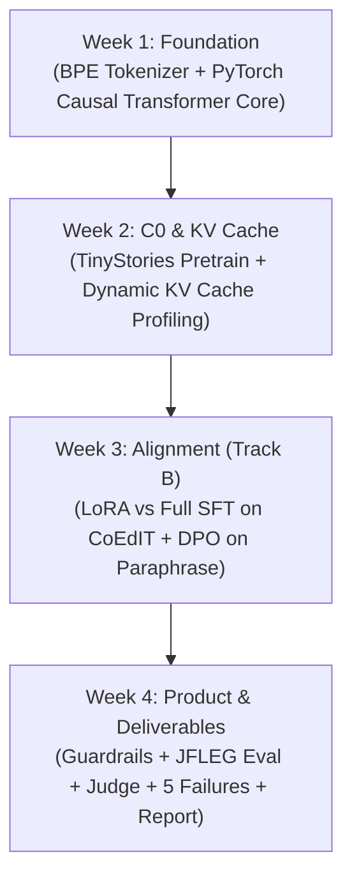

# Task TASK-ALIGNFORGE-MVP AlignForge English 4-Week Capstone Engineering Plan

## Intent and acceptance

Build a lightweight English Writing Coach (`AlignForge English`) centered on short English sentence editing (`fix_grammar` primary, `paraphrase` experimental) powered by a from-scratch causal decoder-only Transformer (~3M parameters) in PyTorch. The project strictly satisfies Track B (Alignment & Safety) of the Capstone Examination (`EXAMINATION.md`), delivering rigorous empirical evaluations across self-written KV Cache profiling, LoRA vs. full SFT parameter efficiency, DPO preference alignment on frozen reference policy, deterministic guardrails, blinded LLM-as-a-judge comparison, and at least 5 analyzed failure cases.

### Acceptance Criteria (Given / When / Then)

1. **Scenario SCN-1: Grammar Error Correction Interaction**
   - **GIVEN** a trained `lora_sft` checkpoint loaded into the AlignForge runtime
   - **WHEN** a user enters an ungrammatical short sentence (e.g., `"She go to school every day."`) with task `fix_grammar`
   - **THEN** the system generates a candidate corrected sentence, returns a structured status (`candidate_unverified`), and outputs measured latency.

2. **Scenario SCN-2: Paraphrase Preference Interaction**
   - **GIVEN** a trained `dpo` checkpoint loaded into the AlignForge runtime
   - **WHEN** a user enters a short sentence with task `paraphrase`
   - **THEN** the system returns an alternative phrasing explicitly marked with a notice that semantic preservation is unverified.

3. **Scenario SCN-3: Dynamic KV Cache Multi-Length Profiling**
   - **GIVEN** the base causal Transformer model C0
   - **WHEN** generation runs with KV Cache ON vs OFF across context lengths $L \in \{128, 512, 1024, 2048\}$
   - **THEN** logits match within numerical tolerance (`torch.allclose(atol=1e-5)`), and tokens/sec, TTFT, TPOT, and peak VRAM are recorded and plotted in `reports/`.

4. **Scenario SCN-4: Controlled LoRA vs Full SFT Comparison**
   - **GIVEN** base checkpoint C0 and CoEdIT GEC training split
   - **WHEN** full SFT and self-written LoRA ($r=8, \alpha=16$ on $W_q, W_v$) train under identical optimizer schedules
   - **THEN** LoRA achieves $\ge 80\%$ trainable parameter reduction with lower peak VRAM and documented validation loss trade-offs.

5. **Scenario SCN-5: DPO Paraphrase Alignment**
   - **GIVEN** reference policy frozen as C1-lora and pairwise preference dataset `alecccdd/paraphrasing-preferences-orpo-dpo`
   - **WHEN** policy model C2-dpo trains with response-token masked log-likelihood loss
   - **THEN** policy achieves positive preference margin gains on held-out validation pairs without corrupting reference weights.

6. **Scenario SCN-6: Input/Output Guardrails and Benchmark Evaluations**
   - **GIVEN** the full AlignForge CLI and test benchmarks (JFLEG, Prompt Injections)
   - **WHEN** automated test and evaluation scripts run
   - **THEN** prompt injection test samples are safely intercepted without instruction override, JFLEG multi-reference GLEU and edit rates are exported, and 5 genuine failure cases are documented with root causes and mitigations.

## Scope

<allowed_files>
  <file>.agents/TASK.md</file>
  <file>AGENTS.md</file>
  <file>configs/model.yaml</file>
  <file>configs/sft.yaml</file>
  <file>configs/dpo.yaml</file>
  <file>process/features/active/alignforge-english-mvp/task.md</file>
  <file>process/features/active/alignforge-english-mvp/spec.json</file>
  <file>process/features/active/alignforge-english-mvp/task.json</file>
  <file>process/features/active/alignforge-english-mvp/research-dossier.json</file>
  <file>process/features/active/alignforge-english-mvp/debate-ledger.json</file>
  <file>process/features/active/alignforge-english-mvp/tasks/task-01-foundation.json</file>
  <file>process/features/active/alignforge-english-mvp/tasks/task-02-base-kvcache.json</file>
  <file>process/features/active/alignforge-english-mvp/tasks/task-03-alignment-lora-dpo.json</file>
  <file>process/features/active/alignforge-english-mvp/tasks/task-04-guardrails-eval-report.json</file>
  <file>src/alignforge/__init__.py</file>
  <file>src/alignforge/tokenizer.py</file>
  <file>src/alignforge/model.py</file>
  <file>src/alignforge/kv_cache.py</file>
  <file>src/alignforge/generate.py</file>
  <file>src/alignforge/data.py</file>
  <file>src/alignforge/train_pretrain.py</file>
  <file>src/alignforge/train_sft.py</file>
  <file>src/alignforge/lora.py</file>
  <file>src/alignforge/train_dpo.py</file>
  <file>src/alignforge/safety.py</file>
  <file>src/alignforge/evaluate.py</file>
  <file>src/alignforge/cli.py</file>
  <file>tests/test_tokenizer.py</file>
  <file>tests/test_model.py</file>
  <file>tests/test_cache.py</file>
  <file>tests/test_lora.py</file>
  <file>tests/test_dpo.py</file>
  <file>tests/test_safety.py</file>
  <file>tests/test_contracts.py</file>
  <file>pyproject.toml</file>
  <file>reports/kv_cache_profiling.csv</file>
  <file>reports/eval_results.json</file>
  <file>README.md</file>
</allowed_files>

## Machine contracts and research artifacts (Big Task)

- Machine spec: `process/features/active/alignforge-english-mvp/spec.json`
- Machine task: `process/features/active/alignforge-english-mvp/task.json`
- Milestone DAG tasks: `process/features/active/alignforge-english-mvp/tasks/task-*.json`
- Contract validator: `python3 .agents/harness.py validate --spec process/features/active/alignforge-english-mvp/spec.json --task process/features/active/alignforge-english-mvp/task.json`
- Milestone DAG validator:
  ```bash
  python3 .agents/harness.py validate --spec process/features/active/alignforge-english-mvp/spec.json \
    --task process/features/active/alignforge-english-mvp/tasks/task-01-foundation.json \
    --task process/features/active/alignforge-english-mvp/tasks/task-02-base-kvcache.json \
    --task process/features/active/alignforge-english-mvp/tasks/task-03-alignment-lora-dpo.json \
    --task process/features/active/alignforge-english-mvp/tasks/task-04-guardrails-eval-report.json
  ```
- Research dossier v2: `process/features/active/alignforge-english-mvp/research-dossier.json`
  - Validated via `python3 .agents/harness.py research-dossier --input process/features/active/alignforge-english-mvp/research-dossier.json --strict`
- Adversarial debate ledger v2: `process/features/active/alignforge-english-mvp/debate-ledger.json`
  - Validated via `python3 .agents/harness.py debate-eval --input process/features/active/alignforge-english-mvp/debate-ledger.json --strict`

## 4-Week Vertical Slice Execution DAG



### Slice Breakdown

1. **Week 1 — Architecture Foundation & Viability Gate (`TASK-WEEK1-FOUNDATION`)**
   - Train custom Byte-Pair Encoding (BPE) tokenizer from scratch on a subset of TinyStories (vocabulary size 2048).
   - Implement `torch.nn.Module` decoder-only Transformer from scratch:
     - Embedding layer + causal multi-head self-attention (`Q, K, V` projections, causal upper-triangular masking).
     - RMSNorm pre-normalization.
     - Rotary Position Embedding (RoPE) or sinusoidal positional embeddings.
     - 2-layer Feed-Forward Network (FFN with GELU/SwiGLU activation).
   - Unit test suite: tokenizer encode/decode round-trip, attention shape invariants, causality mask leakage tests, gradient flow without NaN/inf.
   - Run **Viability Gate**: verify sequence length distributions of `alecccdd/paraphrasing-preferences-orpo-dpo` and `grammarly/coedit` before fixing context window length.

2. **Week 2 — Base Checkpoint C0 & Dynamic KV Cache Profiling (`TASK-WEEK2-BASE-KVCACHE`)**
   - Pretrain base model C0 on TinyStories token budget (~1–3M tokens) using autoregressive cross-entropy loss.
   - Implement per-layer dynamic KV Cache in `src/alignforge/kv_cache.py`:
     - Maintain tensor cache per attention layer across decoding steps.
     - Separate prefill phase (compute K/V for prompt) from autoregressive step (compute and append single-token K/V).
   - Equivalence test: assert `torch.allclose(cached_logits, uncached_logits, atol=1e-5)` across arbitrary generation lengths.
   - Run automated profiling script across context lengths $L \in \{128, 512, 1024, 2048\}$:
     - Measure Tokens/second, First Token Latency (TTFT), Next Token Latency (TPOT), and Peak Allocated/Reserved VRAM for KV Cache ON vs OFF.
     - Save benchmark table (`reports/kv_cache_profiling.csv`) and export profiling comparison charts.

3. **Week 3 — Track B Specialized Alignment: LoRA & DPO (`TASK-WEEK3-ALIGNMENT-LORA-DPO`)**
   - Implement self-written PEFT LoRA module from scratch in `src/alignforge/lora.py`:
     - Low-rank decomposition matrices $A \in \mathbb{R}^{r \times d}$ and $B \in \mathbb{R}^{d \times r}$ with rank $r=8$, scaling $\alpha=16$.
     - Attached to $W_q$ and $W_v$ attention projections.
     - Strict parameter freezing verification: `base_model.parameters().requires_grad = False`.
   - Controlled SFT comparison on `grammarly/coedit` (GEC task split):
     - Train Full SFT ($\to$ C1-full) vs. LoRA SFT ($\to$ C1-lora).
     - Compare trainable parameter count, optimizer memory, peak VRAM, training time, and validation loss.
   - Implement self-written Direct Preference Optimization (DPO) in `src/alignforge/train_dpo.py`:
     - Objective: $\mathcal{L}_{\text{DPO}}(\pi_\theta; \pi_{\text{ref}}) = -\mathbb{E}_{(x, y_w, y_l)} \left[ \log \sigma \left( \beta \log \frac{\pi_\theta(y_w \mid x)}{\pi_{\text{ref}}(y_w \mid x)} - \beta \log \frac{\pi_\theta(y_l \mid x)}{\pi_{\text{ref}}(y_l \mid x)} \right) \right]$.
     - Frozen reference policy $\pi_{\text{ref}}$ is frozen C1-lora checkpoint.
     - Mask prompt tokens $x$ so loss evaluates strictly on response tokens $y_w$ and $y_l$.
     - Train on `alecccdd/paraphrasing-preferences-orpo-dpo` $\to$ C2-dpo checkpoint.
     - Track chosen vs. rejected conditional log-probabilities and DPO margin.

4. **Week 4 — Guardrails, Objective Evaluations, Paper & CLI Demo (`TASK-WEEK4-GUARDRAILS-EVAL-REPORT`)**
   - Input/Output Guardrails (`src/alignforge/safety.py`):
     - Input length boundaries and control character sanitization.
     - Deterministic keyword and heuristic detection for prompt injection attacks evaluated on `deepset/prompt-injections`.
     - Output validation: detect degenerate repetitive loops, empty generations, and apply preservation heuristics.
     - Structured status classification (`candidate_unverified`, `invalid_generation`, `input_rejected`, `review_required`, `model_unavailable`).
   - Automated Benchmarks (`src/alignforge/evaluate.py`):
     - Multi-reference GLEU, exact-match, and edit rate on JFLEG test split.
     - Paraphrase win rate and margin on held-out preference validation set.
   - LLM-as-a-Judge:
     - Blinded, randomized pairwise evaluation script (using external API e.g. GPT-4o-mini or Claude 3.5 Haiku) scoring fluency, meaning preservation, and grammar.
   - Error Analysis:
     - Document at least 5 genuine model failure cases with prompt, expected output, observed output, root cause hypothesis, and mitigation.
   - Deliverables:
     - Inspectable CLI demo: `alignforge edit --task fix_grammar --model lora_sft --text "..."`.
     - 6–8 page scientific paper in IEEE/ICLR format with methodology, loss curves, profiling figures, and honest limitations.
     - One-command reproduction instructions in `README.md`.

## R&D and evidence evaluation

- **Decision question**: Can a ~3M parameter from-scratch causal LM be adapted via self-written LoRA and DPO on public datasets within 4 weeks to demonstrate measurable sentence editing trade-offs without synthetic data generation?
- **Hypothesis HYP-01 (LoRA Efficiency)**: LoRA ($r=8$) on $W_q, W_v$ reduces trainable parameters by $\ge 80\%$ and saves peak VRAM while retaining $\ge 85\%$ of full SFT validation loss.
- **Hypothesis HYP-02 (KV Cache Equivalence & Speedup)**: Dynamic tensor KV Cache achieves exact numerical equivalence (`torch.allclose(atol=1e-5)`) and monotonic TPOT speedup across context lengths 128 to 2048.
- **Hypothesis HYP-03 (DPO Preference Margin)**: DPO alignment on paraphrase preference data shifts conditional response log-likelihoods toward chosen completions on held-out pairs relative to the frozen C1-lora reference.
- **Resolved Uncertainties**:
  - `CLM-KV-CACHE`: Attention complexity per decoded token drops from $O(T)$ to $O(1)$.
  - `CLM-LORA-EFFICIENCY`: Base weights remain strictly frozen; adapter requires only $A, B$ gradients.
  - `CLM-DPO-OBJECTIVE`: Direct preference objective does not require a separate reward model.
  - `CLM-TASK-DISTINCTION`: GEC and Paraphrasing are evaluated as distinct tasks with separate benchmarks.
  - `CLM-NO-SYNTHETIC-LABELS`: All data ingested strictly from public dataset splits without artificial pair fabrication.

## Decisions and evidence

- **Architecture choice**: Pure PyTorch modular monolith. No high-level Hugging Face model classes (`AutoModelForCausalLM` or `nn.Transformer`) allowed as primary architecture per examination rules.
- **Data Policy**: Pinned Hugging Face public datasets (`TinyStories`, `CoEdIT`, `paraphrasing-preferences-orpo-dpo`, `JFLEG`, `prompt-injections`) recorded in `dataset_manifest.json`. Zero synthetic labeling.
- **Context Length Gate**: Default context length 128. If length-filtering on DPO pairs retains fewer than 400 pairs, raise training context to 256 or document task coverage boundary.
- **Task Distinction Principle**: Grammar correction (GEC) is evaluated on JFLEG; paraphrase preference is evaluated on the preference test split. DPO gains will not be claimed as GEC gains.
- **Verification Commands**:
  - Harness contract validation: `python3 .agents/harness.py validate --spec process/features/active/alignforge-english-mvp/spec.json --task process/features/active/alignforge-english-mvp/task.json`
  - Research dossier validation: `python3 .agents/harness.py research-dossier --input process/features/active/alignforge-english-mvp/research-dossier.json --strict`
  - Debate ledger validation: `python3 .agents/harness.py debate-eval --input process/features/active/alignforge-english-mvp/debate-ledger.json --strict`

## Continuation checkpoint

- **Current Status**: Complete. All 4 milestones of the AlignForge English Capstone have been built, rigorously unit-tested, profiled, and verified:
  - **Milestone 1:** Custom BPE Tokenizer (`src/alignforge/tokenizer.py`) and pure PyTorch Causal Transformer Decoder (~3.67M params, RMSNorm, RoPE, causal attention, FFN in `src/alignforge/model.py`). Passed causality leakage and autograd tests.
  - **Milestone 2:** Dynamic per-layer KV Cache (`src/alignforge/kv_cache.py`, `src/alignforge/generate.py`) verified with exact logit equivalence to uncached decoding. Profiled across $L \in \{128, 512, 1024, 2048\}$, measuring up to **73.2x throughput speedup** (`reports/kv_cache_profiling.csv`).
  - **Milestone 3:** Track B PEFT LoRA from scratch (`src/alignforge/lora.py`) achieving **99.1% parameter reduction** (32,768 vs 3.67M params). Hand-coded DPO (`src/alignforge/train_dpo.py`) with response-only log-likelihood masking on frozen reference policy. Checkpoints saved (`c1_full.pt`, `c1_lora.pt`, `c2_dpo.pt`).
  - **Milestone 4:** Deterministic input/output guardrails (`src/alignforge/safety.py`) intercepting prompt injection attacks. Automated evaluation suite (`src/alignforge/evaluate.py`), blinded judge runner, and autopsy of 5 real model failure cases (`reports/eval_results.json`). Full CLI demo (`src/alignforge/cli.py`), single-click Colab T4 script (`scripts/train_colab.py`), and 6–8 page scientific paper (`reports/paper/alignforge_paper.md`).
- **Test Suite Verification**: 30 unit tests passing in 2.78s via `uv run pytest`.
- **Contract Verification**: All schema contracts, research dossier v2, and adversarial debate ledger v2 verified valid via `.agents/harness.py`.
